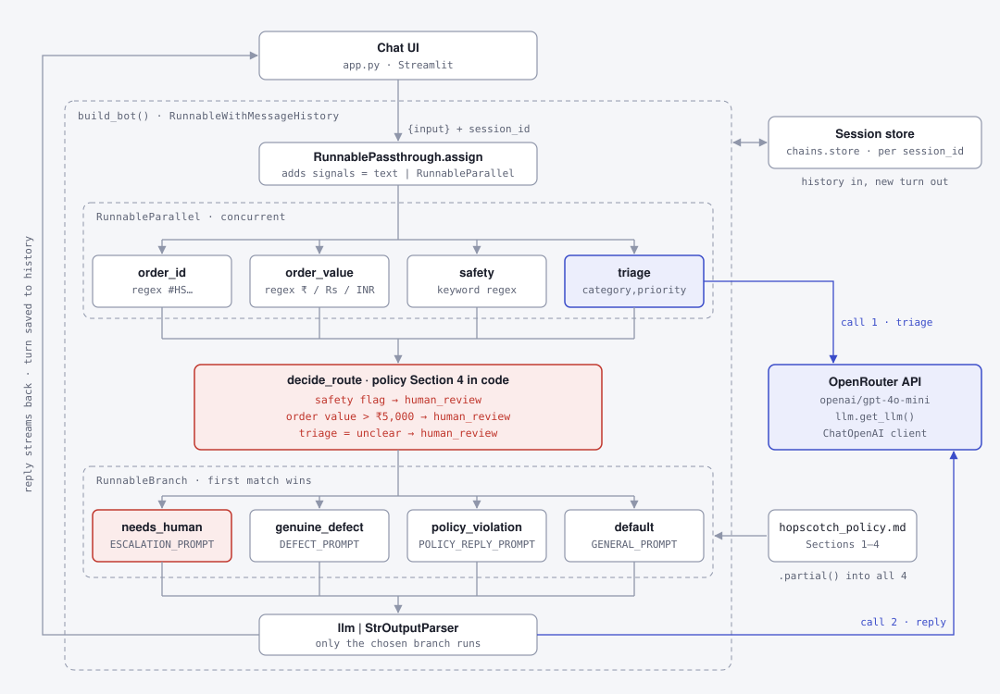

# Hopscotch Support Bot

A customer-support chatbot for **Hopscotch**, a kids' fashion retailer, built with
[LangChain Expression Language (LCEL)](https://python.langchain.com/docs/concepts/lcel/) and Streamlit.

The bot reads a customer message, works out what kind of request it is and replies in the
right style. Cases that the company policy says a person must handle (child safety, skin
reactions, orders over ₹5,000, unclear facts) are always handed to a human. That rule is
enforced in plain Python, not left to the model.

The whole flow is one declarative LCEL pipeline built from `RunnableParallel`,
`RunnableLambda` and `RunnableBranch`, which makes the project a worked example of those
building blocks.

## Architecture



Each message costs two model calls:

1. **Gather signals in parallel.** `RunnableParallel` runs four checks on the message at the
   same time:
   - `triage`: an LLM call that returns `category,priority`
   - `safety`: keyword matching for choking hazards, injuries, rashes and allergies
   - `order_value`: the largest rupee amount mentioned (`₹7,200`, `Rs. 6500`, `INR 5,500`)
   - `order_id`: an order number such as `#HS88213`
2. **Decide the route.** `decide_route` applies policy Section 4. Any of the conditions below
   sends the message to a human, whatever the triage said.
3. **Reply.** `RunnableBranch` picks one of four reply prompts. Every prompt includes the
   policy text and the chat history, and its reply streams back to the UI.

| Condition | Route | Reply prompt |
|---|---|---|
| Safety concern, order over ₹5,000, or triage is `unclear` | `human_review` | `ESCALATION_PROMPT`: hands off to a human without promising an outcome |
| Triage is `genuine_defect` | `defect` | `DEFECT_PROMPT`: explains the 90-day defect cover and asks for photos |
| Triage is `policy_violation` | `policy` | `POLICY_REPLY_PROMPT`: explains the return rule kindly and offers alternatives |
| Anything else | `general` | `GENERAL_PROMPT`: answers from the policy and never invents facts |

If the triage output can't be parsed, the category falls back to `unclear`, so the message
goes to a human.

## Project structure

```
├── app.py                 # Streamlit UI: Chat, Pipeline and Runnables lab tabs
├── chains.py              # The LCEL pipeline, routing rules and session memory
├── prompts.py             # Triage prompt and the four reply prompts
├── llm.py                 # Builds the OpenRouter chat model client
├── hopscotch_policy.md    # Return and refund policy, injected into every reply prompt
├── docs/architecture.svg  # The diagram above
└── tests/                 # Offline test suite (no API key needed)
```

## Getting started

### Prerequisites

- Python 3.13
- [uv](https://docs.astral.sh/uv/) (recommended) or pip
- An [OpenRouter](https://openrouter.ai/) API key

### Install

```bash
git clone https://github.com/syamsruthin/hopscotch-s3-lcel-chatbot.git
cd hopscotch-s3-lcel-chatbot
uv sync
```

With pip instead:

```bash
python -m venv .venv
source .venv/bin/activate
pip install -r requirements.txt
```

### Configure

Copy the example environment file and add your key:

```bash
cp .env.example .env
```

```
OPENROUTER_API_KEY=your_openrouter_api_key_here
```

`.env` is gitignored, so your key stays out of the repo.

### Run

```bash
uv run streamlit run app.py
```

The app opens at <http://localhost:8501>.

## Using the app

The app has three tabs:

- **💬 Chat** is the support bot itself, with memory for each session. Click
  **New session** in the sidebar to start a fresh conversation. Turn on
  **Facilitator mode** to see the internal triage under each reply: the route, why a
  human is needed, and all four signals. This costs one extra model call per message.
- **🔗 Pipeline** shows the pipeline graph, the source of `build_full_chain`, and the
  system prompt of each branch. **Run step-by-step** runs a message through each stage and
  shows what each one outputs.
- **🧪 Runnables lab** has small demos of LCEL features: `|` versus `RunnableSequence`,
  `RunnableLambda`, `RunnablePassthrough.assign`, `.batch()`, `.stream()`, and sequential
  `.assign()` versus `RunnableParallel`.

Six sample tickets, one for each kind of case, are built into the Pipeline and Runnables
lab tabs:

| Sample | Expected route |
|---|---|
| Sole peeling on Dino-Print sneakers after three wears | `defect` |
| Winter jacket worn a few times, wrong size | `policy` |
| Button came off a toddler's shirt and was nearly swallowed | `human_review` (safety) |
| ₹7,200 sneakers peeling at the sole | `human_review` (order value) |
| Dress colour faded, not sure if washed hot | `human_review` (unclear) |
| "Do you ship to Pune?" | `general` |

## Changing the model

OpenRouter puts many providers behind one OpenAI-compatible API. To use a different model,
change `DEFAULT_MODEL` in [`llm.py`](llm.py) to any model ID listed at
<https://openrouter.ai/models>. Nothing else in the app needs to change.

## Testing

```bash
uv run pytest
```

The suite has 133 tests with 100% line coverage, and a coverage report prints after every
run. The tests use `FakeChatModel` (in [`tests/conftest.py`](tests/conftest.py)) in place
of OpenRouter, so they run offline in a few seconds and need no API key.

| File | Covers |
|---|---|
| `test_signals.py` | The regex and keyword checks, and parsing messy triage output |
| `test_routing.py` | `decide_route` and every policy Section 4 rule, including the ₹5,000 boundary |
| `test_chains.py` | The pipeline end to end: routing of every sample ticket, memory and streaming |
| `test_prompts.py` | Policy injection and the inputs each prompt template expects |
| `test_llm.py` | Building the OpenRouter client and failing without a key |
| `test_app.py` | The Streamlit app, run headlessly with `AppTest` |

## Deploying to Streamlit Community Cloud

Point a new app at `app.py` in this repo and add `OPENROUTER_API_KEY` under the app's
**Secrets**. Streamlit installs the dependencies from `requirements.txt`.

## Limitations

- Chat history is kept in memory, so it is lost when the app restarts and isn't shared
  between server processes.
- `RunnableWithMessageHistory` and `InMemoryChatMessageHistory` are deprecated in recent
  LangChain releases and will be removed in LangChain 2.0. They are kept here because they
  show the LCEL memory pattern clearly. A production version should use LangGraph
  persistence instead.
- The safety and order-value checks are keyword and regex based. They are deliberately
  cautious, but they can still miss unusual wording.
